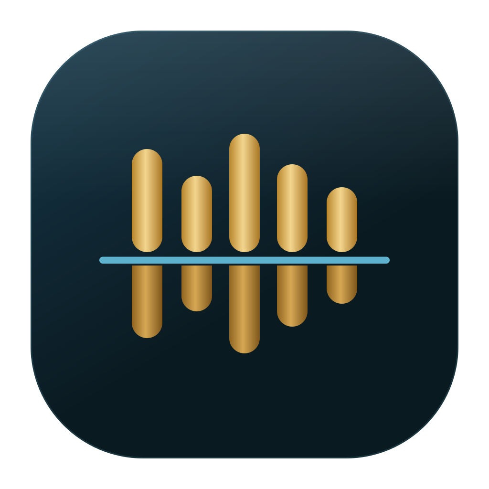

<div align="center">



# LockPin

**Gerenciador de senhas local-first e zero-knowledge, feito com Tauri v2, Rust e React.**

*Como os pinos de uma fechadura, só a chave certa alinha tudo.*

[English](README.md) · **Português**

[](https://www.rust-lang.org)
[](https://react.dev)
[](https://www.typescriptlang.org)
[](LICENSE)
[](https://github.com/sdtx-git/LockPin/releases)

Suas senhas nunca saem do seu dispositivo. Sem contas. Sem sincronização em nuvem. Sem telemetria.

</div>

---

## Por que o LockPin?

A maioria dos gerenciadores de senhas guarda seus dados na nuvem deles e cobra uma mensalidade por isso. O LockPin faz o contrário: **seu cofre fica no seu disco, criptografado, e só você tem a chave.**

- **Pronto para air-gap** — funciona totalmente offline, sempre
- **Portátil** — uma pasta num pendrive roda no Windows e no Linux com o mesmo cofre
- **Sem aprisionamento** — código aberto, seus dados continuam seus
- **Zero-knowledge** — o app nunca vê suas senhas em texto puro
- **Desempenho nativo** — backend em Rust, desbloqueio em menos de 100 ms

---

## Funcionalidades

### Segurança
| Funcionalidade | Detalhes |
|---|---|
| **Criptografia** | AES-256-GCM com chaves por cofre |
| **Derivação de chave** | Argon2id (64 MB, 3 iterações) + PBKDF2-SHA-256 (600 mil iterações) |
| **Windows Hello** | Desbloqueio por biometria/PIN com chave mestra protegida por DPAPI (só Windows) |
| **Senha de coação** | Abre um cofre isca separado (`vault-decoy-{id}.enc`) sem revelar nem tocar no cofre real |
| **Kill switch** | Destrói o cofre, a isca e os backups ao digitar uma senha específica; os anexos são apagados quando não resta outro cofre |
| **Recuperação** | Frase de 12 palavras no estilo BIP39, criptografada separadamente do cofre |
| **Bloqueio automático** | Tempo configurável, com aviso 30 segundos antes |
| **Anti-debug** | Detecta depurador (API do Windows / `TracerPid` no Linux) e encerra na hora |
| **Exclusão segura** | Sobrescreve os arquivos do cofre com bytes aleatórios antes de removê-los |
| **Limite de tentativas** | Proteção contra força bruta no Rust em todas as operações do cofre |
| **CSP** | Content Security Policy estrita pela camada de segurança do Tauri |

### Cofre
| Funcionalidade | Detalhes |
|---|---|
| **Vários cofres** | Um cofre independente por senha mestra, coexistindo na mesma máquina |
| **Tipos de item** | Senhas, sementes TOTP, passkeys, cartões de crédito, notas seguras, identidades |
| **TOTP** | Autenticador embutido — gera códigos no app (SHA-1/256/512, 6–8 dígitos, qualquer período); aceita links `otpauth://` e imagens de QR code |
| **Importação** | Bitwarden, Chrome e CSV genérico; autenticadores do Google Authenticator (QR de transferência), Aegis (JSON sem criptografia), 2FAS (sem senha) e listas `otpauth://` |
| **Arquivos seguros** | Anexos de até 50 MB por item, guardados como blobs criptografados |
| **Pastas** | Organização em pastas coloridas; arquivos guardados por pasta |
| **Lixeira** | Exclusão reversível, com restauração e esvaziamento |
| **Log de auditoria** | Registro imutável de ações por organização |
| **Gerador de senhas** | Tamanho e conjunto de caracteres configuráveis, medidor de força |
| **Área de transferência** | Limpa automaticamente 10 segundos depois de copiar |
| **Busca** | Filtro instantâneo por título, usuário, URL e tags |
| **Backups** | Backup automático no máximo a cada 10 minutos em `backups/vault-{id}-{timestamp}.enc`, mantendo os 20 mais recentes por cofre |

### UX
- Identidade visual baseada no cilindro de pinos: pinos de latão divididos numa linha de corte azul; na tela de login, os pinos se movem enquanto você digita e se alinham no desbloqueio
- Tema escuro e claro, com troca ao vivo
- Doze paletas de cores em Configurações, cada uma em claro e escuro: LockPin (padrão: petróleo profundo e latão), Petróleo, Cofre, Técnico, Monocromático, Alto contraste, AMOLED, Floresta, Oceano, Ametista, Vinho, Terracota
- Layout responsivo: abaixo de 720px a barra lateral vira gaveta, lista e detalhe viram telas separadas e os diálogos viram bottom sheets
- Navegação por atalhos de teclado (`Ctrl N` novo item, `Ctrl F` busca, `Ctrl L` bloquear)
- Indicador de força da senha
- Barra lateral recolhível, com visões por coleção e por pasta

---

## Arquitetura

```
LockPin/
├── src-tauri/                  # Backend em Rust (Tauri v2)
│   ├── src/lib.rs              # Argon2, DPAPI, limite de tentativas, I/O atômico, local dos dados
│   ├── icons/app-icon.svg      # Origem de todos os ícones do app (npx tauri icon)
│   └── gen/android/            # Projeto Android (MainActivity e manifest próprios)
├── core/
│   ├── crypto/                 # AES-256-GCM, PBKDF2, HMAC
│   └── vault/                  # Armazenamento, tipos, TOTP, importação/exportação, saúde
├── apps/desktop/               # Telas: Login, Vault, FolderPane, VaultItemDialog
├── ui/
│   ├── components/             # Átomos (Logo, TitleBar, Button), moléculas, organismos (Modal, Toast)
│   ├── contexts/               # ThemeContext (tema + paleta), useDebounce, useKeyboard
│   └── design-system/          # global.css (tokens e paletas), tokens.ts
├── shared/                     # Constantes, tipos, utilitários
├── src/main.tsx                # Raiz React, estado de autenticação, ciclo de vida do cofre
├── docker/                     # Dockerfile.dev, Dockerfile.portable, launcher LockPin.sh
├── code/docker-dev.ps1         # Build, testes, execução, APK e build portátil via Docker
└── .github/workflows/          # Pipeline de release (instaladores + zip portátil)
```

### Fluxo de dados

```
Entrada do usuário
    │
    ▼
UI React (TypeScript)
    │  invoke()
    ▼
Ponte IPC do Tauri
    │
    ▼
Comandos Rust (lib.rs)
    │  limite de tentativas → I/O de arquivo
    ▼
vault-{uuid}.enc  ←→  vaults.auth (registro de autenticação, uma linha por cofre)
```

### Formato do arquivo do cofre

Cada cofre é guardado como `vault-{uuid}.enc` — um blob JSON criptografado com AES-256-GCM:

```
[4 bytes: tamanho do salt] [salt] [12 bytes: IV] [texto cifrado] [16 bytes: tag de autenticação GCM] [32 bytes: HMAC-SHA256]
```

A autenticação fica separada, em `vaults.auth`:

```
{vault_id}|{master_salt}|{master_hash}|{duress_salt}|{duress_hash}|{kill_salt}|{kill_hash}|{dpapi_blob}|{recovery_blob}
```

Com essa separação, o arquivo do cofre não contém nenhuma credencial — quem obtiver só o `vault-*.enc` não consegue tentar ataques de dicionário offline sem a entrada de autenticação correspondente.

---

## Primeiros passos

### Download (recomendado)

Instaladores prontos estão na página de [Releases](https://github.com/sdtx-git/LockPin/releases).
Nenhuma ferramenta de build é necessária:

- **Linux** — `.deb`, `.rpm` ou `.AppImage`
- **Windows** — instalador `.msi` ou `.exe`
- **Portátil** — `LockPin-portable-<versão>.zip` com `LockPin.exe`, `LockPin.AppImage` e `LockPin.sh`; descompacte num pendrive (veja [Portátil](#portátil-pendrive-windows--linux))

Os binários do Windows ainda não têm assinatura de código. No Windows 11 com o **Controle Inteligente de Aplicativos** ativado, eles podem ser bloqueados; o SmartScreen também pode pedir confirmação na primeira execução.

O Android está em andamento (APK de debug gerado via Docker); o iOS está planejado.

### Local dos dados

| Plataforma | Caminho |
|---|---|
| Linux (AppImage / portátil) | `$LOCKPIN_DATA_DIR`, se definido; senão, ao lado do `.AppImage` |
| Linux (demais) | `$XDG_DATA_HOME/lockpin` (padrão `~/.local/share/lockpin`), diretório `0700`, arquivos `0600` |
| Windows | Ao lado do executável, quando a pasta aceita escrita ou já tem um cofre (portátil); senão, `%APPDATA%\LockPin` (instalado em `Program Files`) |

Os arquivos são gravados de forma atômica (arquivo temporário + renomeação), então remover o pendrive no meio de um salvamento preserva a versão anterior.

### Portátil (pendrive, Windows + Linux)

`code\docker-dev.ps1 portable` gera `build-portable/LockPin/` com `LockPin.exe`, `LockPin.AppImage` e `LockPin.sh`. Copie a pasta para o pendrive: os dois sistemas usam o mesmo cofre nessa pasta. No Windows, rode `LockPin.exe`; no Linux, rode `sh LockPin.sh` (funciona sem FUSE e em drives montados com `noexec`). O desbloqueio pelo Windows Hello só funciona no PC em que foi ativado; nos demais, use a senha mestra.

### Build a partir do código

**Pré-requisitos**

- [Node.js 18+](https://nodejs.org)
- [Rust 1.80+](https://rustup.rs)
- [Pré-requisitos do Tauri](https://tauri.app/start/prerequisites/) para a sua plataforma

No Debian/Ubuntu:

```bash
sudo apt-get install -y libwebkit2gtk-4.1-dev libayatana-appindicator3-dev librsvg2-dev libxdo-dev libssl-dev build-essential file
```

```bash
git clone https://github.com/sdtx-git/LockPin.git
cd LockPin

npm install
npm run tauri:build
```

O instalador é gerado em `src-tauri/target/release/bundle/`.

### CI / Releases

Enviar uma tag dispara o pipeline do GitHub Actions, que compila em runners limpos de Linux e Windows, publica os instaladores no GitHub Releases e monta o zip portátil a partir dos dois builds:

```bash
git tag v3.0.1
git push origin v3.0.1
```

### Scripts úteis

```bash
npm run typecheck     # Checagem do TypeScript (sem emitir)
npm run lint          # ESLint
npm run test          # Testes unitários com Vitest
cargo check           # Checagem de tipos do Rust (rodar dentro de src-tauri/)
```

### Docker (desenvolvimento no Windows)

Faça build, teste e rode o app sem instalar Node nem Rust na máquina. A interface abre pelo WSLg.

```powershell
powershell -ExecutionPolicy Bypass -File code\docker-dev.ps1 build   # gera a imagem de dev (uma vez)
powershell -ExecutionPolicy Bypass -File code\docker-dev.ps1 test    # sincroniza o código + typecheck, vitest, cargo check, cargo test
powershell -ExecutionPolicy Bypass -File code\docker-dev.ps1 run     # sincroniza o código + tauri dev (janela via WSLg)
powershell -ExecutionPolicy Bypass -File code\docker-dev.ps1 sync    # envia as edições para o container em execução (hot reload)
powershell -ExecutionPolicy Bypass -File code\docker-dev.ps1 shell   # bash dentro do container
powershell -ExecutionPolicy Bypass -File code\docker-dev.ps1 down    # remove o container (os volumes são mantidos)
powershell -ExecutionPolicy Bypass -File code\docker-dev.ps1 android-init  # regenera src-tauri/gen/android
powershell -ExecutionPolicy Bypass -File code\docker-dev.ps1 apk     # APK de debug (arm64) em build-android/
powershell -ExecutionPolicy Bypass -File code\docker-dev.ps1 portable  # LockPin.exe + LockPin.AppImage em build-portable/LockPin/
```

O código é copiado para o container (sem bind mount), então rode `sync` depois de editar. Os dados do cofre de teste ficam no volume `lockpin-data`, isolados da máquina.

---

## Modelo de segurança

A segurança do LockPin se apoia em três pilares:

**1. Nenhuma superfície de servidor** — não há servidor de backend, API nem sistema de contas. A superfície de ataque se limita ao sistema de arquivos local e à ponte IPC do Tauri.

**2. Derivação de chave em camadas** — desbloquear exige saber a senha mestra e ter acesso ao arquivo local `vaults.auth`. Nenhum dos dois basta sozinho.

**3. Defesa em profundidade** — mesmo que um atacante contorne a UI, a camada Rust aplica limites de tentativas, apaga os arquivos do cofre antes de excluí-los, detecta depuradores e desativa crash dumps para impedir análise forense da memória.

### Contra o que o LockPin NÃO protege

- Um sistema operacional totalmente comprometido (keyloggers, acesso root)
- Acesso físico a uma máquina desbloqueada
- Ataques por gravação de tela

---

## Roadmap

- [x] Suporte a Linux
- [x] Modo portátil (uma pasta no pendrive para Windows e Linux)
- [ ] Android (layout mobile pronto; build de release pendente)
- [ ] Sincronização entre desktop e celular pela rede local, com criptografia ponta a ponta, sem nuvem
- [ ] Builds do Windows com assinatura de código
- [ ] Suporte a macOS
- [ ] Desbloqueio biométrico no Linux
- [ ] Extensão de navegador (preenchimento automático)
- [ ] Exportação / importação criptografada (formato compatível com Bitwarden)
- [ ] Compartilhamento de senhas por QR code criptografado
- [ ] YubiKey como segundo fator

---

## Licença

MIT © 2025 — veja [LICENSE](LICENSE) para mais detalhes.
